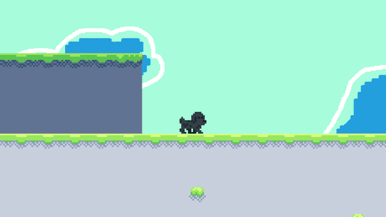
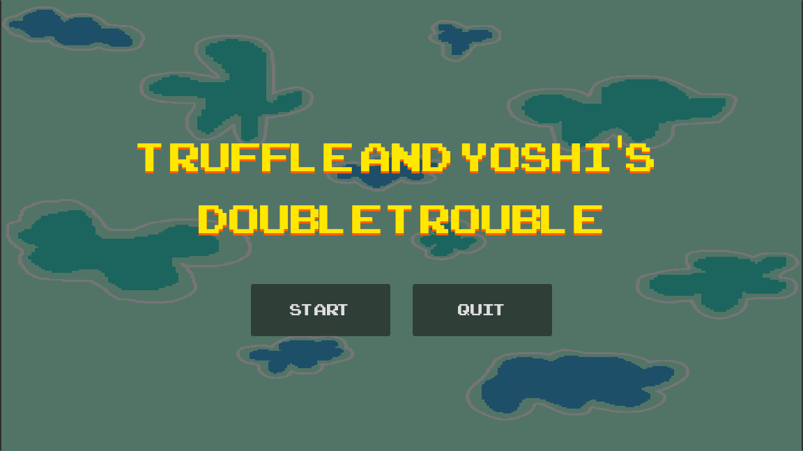
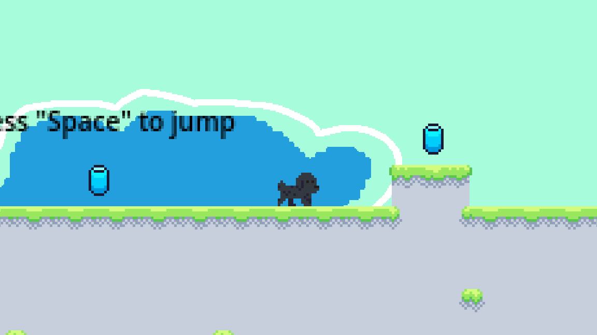
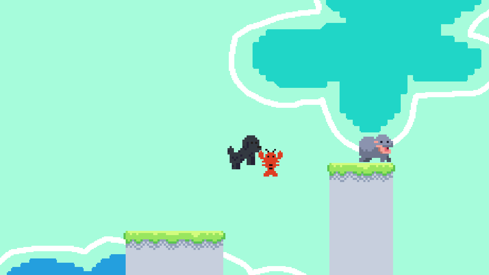
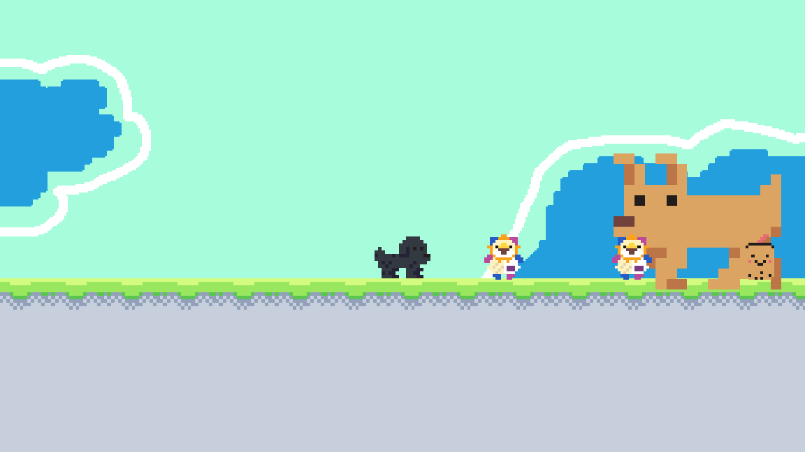
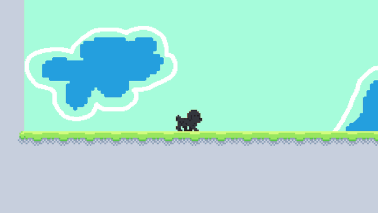

# Truffle & Yoshi: Double Trouble

A small 2D pixel-art platformer shooter made with Godot 4.5. Play as Truffle the dog, jump across floating islands, shoot your way past the critters in your path and take on the boss at the end.

## Play

Download the Windows build from the [latest release](https://github.com/jjiayyingtt/truffle-and-yoshi-double-trouble/releases/latest), extract the zip and run `Truffle & Yoshi Double Trouble.exe`. Keep the `.pck` file in the same folder as the `.exe`.

## Controls

| Action | Input |
| --- | --- |
| Move | `A` / `D` |
| Jump | `Space` |
| Double jump | `Space` again in mid-air |
| Shoot | Left mouse button |
| Pause | `Esc` |

One hit from an enemy or an enemy bullet ends the run, so shoot first.

## Screenshots

| | |
| --- | --- |
|  |  |
|  |  |

### Boss fight

## What's in the game

- **Level 1:** a tutorial stretch, then pillars, gaps and moving platforms leading to a portal.
- **Enemies:** patrolling Moo Dengs, a jumping bad dog and shooters that fire back once you get close.
- **Boss area:** a giant dog that charges, jumps and takes three hits to beat.
- **Projectiles:** Truffle fires a random pick of bubble tea, lions and lobsters.

## Run from source

1. Install [Godot 4.5](https://godotengine.org/download) or newer.
2. Clone this repo and open `project.godot` in the Godot editor.
3. Press `F5` to run.

The background music is not included in the repo. `scripts/audio_player.gd` preloads it, so add your own track at that path (or change the path in the script) before running from source.

## Project layout

| Folder | Contents |
| --- | --- |
| `scenes/` | Levels, player, enemies and menus |
| `scripts/` | GDScript for the player, enemies and game manager |
| `assets/` | Sprites, tiles, font and sound effects |
| `docs/media/` | Screenshots and GIFs used in this README |
